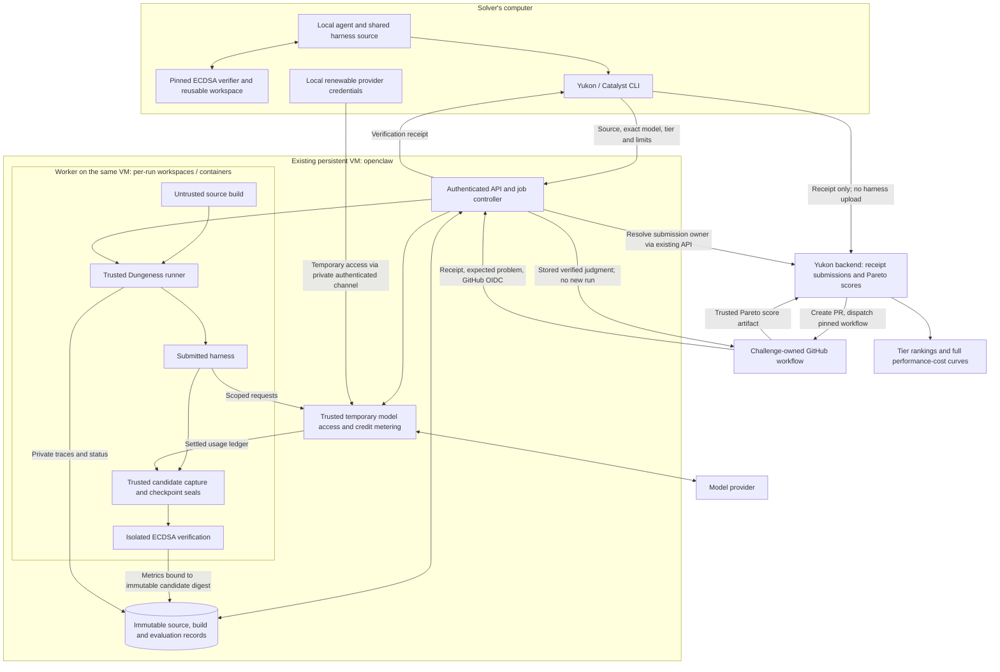

# Catalyst architecture

Develop and test locally on the Mac first. The initial remote MVP runs both the
authenticated API and the harness worker inside the existing VM reached through
`ssh openclaw`. The VM stays running and is reused across jobs. The worker builds
and runs harnesses in separate run workspaces/containers and verifies captured
candidates in a trusted workspace. No per-evaluation VM provisioning or teardown
is part of this MVP. Agent Compose, new cloud resources, a vault and a reverse
proxy are unnecessary for the initial implementation.

The initial challenge is exclusively **ecdsa.fail**, compared at **$20 and $200 checkpoints, plus Best achieved**. See [tier accounting](tier-accounting.md). Continuous
execution with budget checkpoints remains a proposal, not a scheduling decision.

## Identities and evidence

Source identity includes executable code, build recipe, dependencies,
instructions and knowledge. Runtime settings and the verification reference are
excluded from that source hash. Bind each evaluation separately to source,
server-built image digest, the ECDSA pin, exact provider/model, spending cap,
resource limits, pricing digest, policy digest and authenticated owner.

Use distinct request, build and evaluation IDs. Retries reuse their original
operation key; deliberate repeats get a new evaluation ID. The server can reuse
an immutable build for unchanged source. Changed source or settings require new
remote evidence. A reference file or local score is not an attestation.
Yukon receives only the receipt. Its standard GitHub Actions runner dispatches
the challenge workflow, which resolves it with Catalyst. The submitted
receipt identifies the previously evaluated harness, even if local files have
subsequently changed. Catalyst retains that harness and its evaluation settings;
Yukon does not need another source upload or a local source comparison.

Official measurements require trusted usage settlement, immutable candidate
capture, checkpoint seals and independent verification. Keep the complete
verified curve, infrastructure usage, and private traces before cleaning up the
job's processes, containers and temporary workspace. Keep the remote VM running
for subsequent jobs.
Public metrics contain allowlisted result fields; provider credentials and raw
traces stay out of submissions and public artifacts.

## Credentials and implementation boundary

The final service will accept user-authorized provider credentials over authenticated
HTTPS (port 443) and provide scoped access to trusted execution components.
Credential upload, protected storage, expiration, revocation and renewal remain
separate implementation work; this MVP keeps model access disabled.
The submitted harness receives scoped model access; builds receive none.
The implementation must preserve original credentials during cancellation and
cleanup. No vault or reverse proxy is required. API and subscription renewal
flows still need implementation; see [runtime requirements](runtime-platform-requirements.md).

Implemented: local packaging/build/smoke tools, Dungeness adapter, pinned ECDSA
workspace, tier viewer, credit/checkpoint validators, remote client and submission
workflow. The local API now persists jobs, ownership, immutable submission
bindings and results in SQLite. The server starts and supervises a separate
worker process, which runs the real Dungeness/Docker path, retains private
evidence and independently verifies a frozen candidate. The pinned ECDSA
baseline runs with model access disabled; a smaller circuit fixture uses a mock
provider to test accounting. Worker failure stops the API; service shutdown stops
the owned worker and its reported execution processes. Queued work survives,
and interrupted attempts are marked failed without automatic replay.
The private VM deployment runs under `screen` with provisioned solver and Yukon
consumer keys. The current integration uses stock Yukon's GitHub Actions runner,
receipt-only archives and a signed-OIDC result endpoint. Experimental custom
Yukon patches are preserved but not required. See [the end-to-end guide](github-actions-e2e.md) and
[the reproducible local check](local-evaluation.md).

Pending: GitHub App/connection setup and hosted benchmark registration, automatic account/grant provisioning, temporary
provider access and renewal for ECDSA research runs, runtime checkpoint
capture and credit reservations, artifact retention policy, hosted benchmark
registration and the real Yukon board integration. Local fixture modes remain
separate and cannot be relabeled as remote ECDSA evidence.

## Service extraction

The reusable verification service owns upload, queueing, execution, authentication,
immutable receipts and result retrieval. Catalyst owns ECDSA task pins, verification
and scoring policy, model-credit rules and the challenge workflow. Keep those
boundaries explicit while validating this integration; a separate service package
or repository can follow without changing the solver's receipt workflow.
