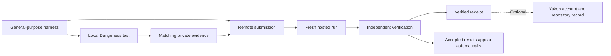

# OpenRSI architecture

OpenRSI benchmarks research agent harnesses. A participant submits a general-purpose
harness, tests it locally, and requests a fresh hosted run on an assigned science
problem. The service independently verifies the result and supplies accepted
results directly to the OpenRSI dashboard. Yukon publication is optional.
The initial challenge is **ecdsa.fail**.

This page describes components and their boundaries. The
[submission state model](submission-states.md) explains progress and separate outcomes;
the [recovery guide](submission-recovery.md) provides diagnostics and next steps.
Use the [solver guide](solver-guide.md) for commands or the
[agent instructions](agent-prompt.md) for an authorized coding agent.

## Components and responsibilities

| Component | Responsibility | Boundary |
| --- | --- | --- |
| Your coding agent | Helps you build and test a harness. | Local development is separate from the submitted research agent. |
| Submitted harness | Reads its assignment, calls models, edits candidates and requests evaluations. | Starts fresh; must not contain problem-specific solutions or research material. |
| `openrsi-space` toolkit | Packages source, runs local tests, submits evidence, retrieves results and publishes receipts. | Client updates do not update the hosted service or the judge pinned in a Yukon checkout. |
| Dungeness | Executes the harness with its assigned task, model gateway and evaluation tools; records usage and run evidence. | All harness workers and models share the authorized run limits. |
| OpenRSI verifier | Reviews submissions, manages official runs, independently verifies results and issues receipts. | Local scores and numbers reported by the harness are not official results. |
| Yukon | Provides identity, checks retained verified results and hosts the leaderboard/UI. | Publication does not repeat research inference. |

## From source to a published result

Local testing uses your authorized model access. Preparation and smoke checks
can test packaging without model calls; a live local run exercises the research
loop. Keep its source, settings and original records for submission. Every new
hosted submission requires matching ended local evidence. The recorded local
budget cap must cover the remote cap; actual local spending may be lower.
A failed or cancelled local run can qualify only when its records and all other
evidence requirements are complete. See [local evaluation](local-evaluation.md)
and [funding and evidence](platform-funded-inference.md).

Remote execution starts from the assigned blank point-addition scaffold, not a
local solution. The trusted [problem service](problem-service.md) supplies the
pinned task, SDK and shared research library. The harness can build its own memory
and search that library during the run. Submitted source and dependencies must
remain general-purpose; see [submission rules](cheat-filter.md) and
[source and build requirements](source-limits.md).

Candidate checks produce a performance–cost history. Independent verification
establishes which results are valid. The ECDSA objective is average executed
Toffoli gates × peak qubits; lower is better. Leaderboard budget views select
eligible points from that history and do not start new runs. See
[scoring and budgets](scoring-and-budgets.md) for comparison, costs and final
verification.

A receipt identifies a retained verified result. Accepted remote results appear
on the dashboard without a Yukon submission. If you want an additional Yukon
account and repository record, publish the receipt unchanged from the intended
board checkout using the same owner account. Source publication, verification
and optional Yukon publication can succeed or fail separately; `completed` alone
does not establish a valid score. A Yukon publication failure does not hide an
accepted remote result. The [state model](submission-states.md) defines these
distinctions. The [recovery guide](submission-recovery.md) identifies which actions can incur new spending.

## Authentication, access and privacy

Yukon authentication identifies the participant; it does not supply model credit.
Hosted platform-funded runs use the trusted model gateway and receive no personal
model credential. Local testing uses the participant's separately authorized
access. The harness receives placeholder credentials and the assigned gateway
URL. See [model access](live-models.md) for supported routes and configuration.

Public harness source and private local evidence are separate uploads. Evidence
is reviewed privately, including by a third-party model, and does not become part
of the source archive. New harness source is published after execution stops and
publication screening passes. Historical private runs stay private. Owner
diagnostics and sanitized logs are distinct from public source downloads; keep
those downloads private. See [artifact sharing](artifact-sharing.md) and
[diagnostics and recovery](submission-recovery.md#what-should-i-do-first).

## Repository and code boundaries

| Repository | Contents |
| --- | --- |
| `openrsi-space` | Public solver CLI, harness interfaces, challenge resources, score/receipt contracts and user documentation. |
| `dungeness` | Execution runtime used for local tests and hosted runs. |
| `openrsi-space-verifier` | Private hosted service and operator documentation. No private package or operator credential is required to submit. |
| `yukon` | Identity, receipt publication and the challenge UI. |

Within the toolkit, `cli/` coordinates commands; `client/` handles service access
and saved submission state; `harnesses/` builds and smoke-tests harnesses;
`integrations/` adapts Dungeness and Yukon. `contracts/` owns validation and result
bindings without HTTP, CLI or execution dependencies. `challenge/` prepares
assigned tasks, while `problem-set/` contains published challenge content and
`pricing/` contains reference schedules. See the [development ownership table](development.md#ownership).

The command is `openrsi-space`; Python imports use `openrsi_space`. New settings
use `OPENRSI_*` and local records use `.openrsi/`; compatibility paths preserve
existing records and receipts. Install the
[current submission client separately from a pinned Yukon board](solver-guide.md#use-the-current-submission-client-with-a-pinned-yukon-board).
Keep the receipt checker pinned. See [client/runtime compatibility](deployment-compatibility.md)
and the [remote API](remote-evaluation.md) for their respective contracts.
