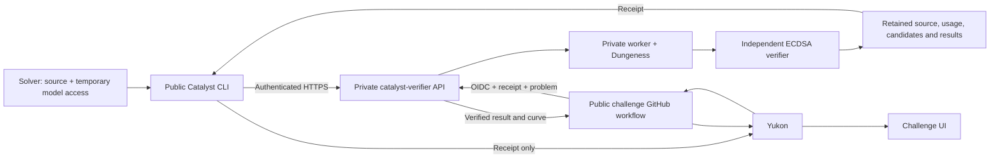

# Catalyst architecture

## Public repository

`catalyst-research` provides the solver CLI, temporary credential encoding,
canonical source bundles, local build/smoke tools, pinned problem definition,
pricing and score validation, receipt retrieval and Yukon integration.
The public library uses the Python standard library. Local Docker smoke tests
require Docker; problem verification requires the upstream task's toolchain.

The public entrypoint is `catalyst`. It does not start the verification service,
run anti-cheat screening, hold an operator credential or require Dungeness.
The challenge UI lives in Yukon; Catalyst does not include a separate viewer.

The public ECDSA statement lives in `src/catalyst/problem-set/ecdsa.fail.md`.
The private service copies it into a versioned problem package during
initialization. For each run, it builds a read-only problem service from
Catalyst's `runtime/problem_server.py`, independently of the submitted harness.
Dungeness wires this service into Compose and exposes the assigned document
through the gateway's `GET /task`. See [the task contract](problem-service.md).

Knowledge files, memory and retrieval software are part of the submitted harness
image. Catalyst does not extract them into a knowledge-base sidecar or prescribe
how the agent reads them. Their bytes are covered by the harness source and image
identities. The trusted problem service is separate from those agent-owned files.

## Private service

`catalyst-verifier` provides its own Python package (`catalyst_verifier`) and
operator entrypoint (`catalyst-verifier`). It depends on an exact public package
version. Its source includes the API, job store, worker lifecycle, Dungeness
integration, anti-cheat screening, provider staging, artifact storage and deployment
configuration. The packages have separate tests and distribution contents.

Moving source does not change the deployed service, HTTPS endpoint, retained
evaluation IDs, database schema or receipt protocol. Deploying the extracted
service is a separate operator action after testing.

## Trust and privacy

The solver authorizes use of their model account for a specific run and cap.
Refresh credentials remain local. Model access is sent separately from source
and receipts over authenticated HTTPS. See [model access](live-models.md).

The service binds evidence to the authenticated owner, pinned problem,
source/image/configuration/pricing/policy identities and metered usage. Yukon
accepts only the result retrieved by its trusted workflow. Locally edited
score JSON is not authoritative.

New submissions require public harness source, published after the run stops and
publication screening passes. Solvers cannot opt out or unpublish source. Traces are retained internally for verification and debugging. Historical private runs stay private. Owners can download
harness source or change its visibility; see [artifact sharing](artifact-sharing.md).
The UI reads Yukon's official metrics and requests artifact metadata only when
run details are opened. It does not enumerate private evaluations.
