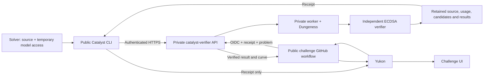

# Catalyst architecture

The standard workflow is **build → test locally with Dungeness → fix failures →
remote evaluation → publish the verified receipt to Yukon**.

| Component | Role |
| --- | --- |
| Your local coding agent | Helps build and test the general-purpose harness with your authorization. |
| Submitted harness | Runs autonomously: reads its assignment, calls models, edits and evaluates candidates. |
| Catalyst CLI | Packages the harness and assigned problem, starts local runs and submits official evaluations. |
| Dungeness | Public execution backend coordinating Docker containers, the model gateway, problem service and evaluator; meters usage, enforces limits and records evidence. |
| Catalyst verifier | Hosted service that screens source, runs Dungeness, independently verifies results and issues receipts. |
| Yukon | Validates the receipt's retained result and displays accepted submissions; does not repeat inference. |

Start with [local testing](local-evaluation.md): install Git, uv and Docker,
clone a clean Dungeness checkout anywhere, discover the active problem release,
and use `catalyst local run HARNESS_DIR --dungeness PATH --prepare-only` with
configured model and limits. Catalyst generates the run spec and starts local
services automatically during execution; no manual problem server is needed.

Preparation builds without model calls. With a separately authorized local budget,
remove `--prepare-only` and supply model access to test the full research loop.
Inspect failures and fix the harness before remote submission. Keep each evaluation
fresh; do not carry local solutions or task-specific notes into the harness.
Local results do not replace private screening, independent verification or receipts.
If testing is blocked or declined, report the untested steps explicitly. The API
does not enforce this recommended preflight.

## Public repository

`catalyst-research` provides the solver CLI, temporary credential encoding,
canonical source bundles, local build/smoke tools, pinned problem definition,
pricing and score validation, receipt retrieval and Yukon integration.
The public library uses the Python standard library and PyYAML. Local Docker smoke tests
require Docker; problem verification requires the upstream task's toolchain.

The public entrypoint is `catalyst`. It does not start the verification service,
run anti-cheat screening, hold an operator credential. The local-run path requires a Dungeness checkout;
remote submission uses the service’s runtime.
The challenge UI lives in Yukon; Catalyst does not include a separate viewer.

The public ECDSA statement lives in `src/catalyst/problem-set/ecdsa-fail/description.md`.
The private service copies it into a versioned problem package during
initialization. For each run, it builds a read-only problem service from
Catalyst's `runtime/problem_server.py`, independently of the submitted harness.
Dungeness wires this service into Compose and exposes the assigned document
through the gateway's `GET /task`. See [the task contract](problem-service.md).

Knowledge files, memory and retrieval software are part of the submitted harness
image. Catalyst does not extract them into a knowledge-base sidecar or prescribe
how the agent reads them. Their bytes are covered by the harness source and image
identities. The trusted problem service is separate from those agent-owned files.

## Module boundaries

`cli/` parses arguments and coordinates commands. `client/` owns HTTP, login
sessions, resumable submission state and catalog downloads. `contracts/` owns
validation, accounting and result bindings shared with the verifier; it has no
HTTP, CLI or execution dependency. `harnesses/` owns local Docker build/smoke
mechanics, while `integrations/` adapts Dungeness and Yukon.

Small shared primitives and credential/profile helpers remain at package root.
Old import paths forward to the owning modules so existing verifier versions
and callers keep working. Add new code to the canonical packages. See the
[development ownership table](development.md#ownership) and directory READMEs.

## Challenge code and content

`src/catalyst/challenge/` owns shared release loading, resource validation and
preparation, asset installation, and assigned task assembly. Its directory README
identifies the entry points. Public callers use `catalyst.challenge.*`; the old
`problems`, `problem_assets`, `paper_library`, `knowledge_base`, and `task_setup`
module paths remain compatibility aliases for existing verifier releases.

`src/catalyst/problem-set/` owns the challenge content: descriptions, release
manifests, paper catalogs, scaffolds and verifier bundles. Its paths and published
content stay stable when preparation code moves. Pricing remains in `pricing/`.

## Private service

`catalyst-verifier` provides its own Python package (`catalyst_verifier`) and
operator entrypoint (`catalyst-verifier`). It depends on an exact public package
version. Its source includes the API, job store, worker lifecycle, Dungeness
integration, anti-cheat screening, provider staging, artifact storage and deployment
configuration. The packages have separate tests and distribution contents.

Moving source does not change the deployed service, HTTPS endpoint, retained
evaluation IDs, database schema or receipt protocol. Deploying the extracted
service is a separate operator action after testing.

## Trust and privacy

The solver authorizes use of their model account for a specific run and cap.
Refresh credentials remain local. Model access is sent separately from source
and receipts over authenticated HTTPS. See [model access](live-models.md).

The service binds evidence to the authenticated owner, pinned problem,
source/image/configuration/pricing/policy identities and metered usage. Yukon
accepts only the result retrieved by its trusted workflow. Locally edited
score JSON is not authoritative.

New submissions require public harness source, published after the run stops and
publication screening passes. Solvers cannot opt out or unpublish source. Traces are retained internally for verification and debugging. Historical private runs stay private. Owners can download
harness source or add an authorized license; see [artifact sharing](artifact-sharing.md).
The UI reads Yukon's official metrics and requests artifact metadata only when
run details are opened. It does not enumerate private evaluations.
