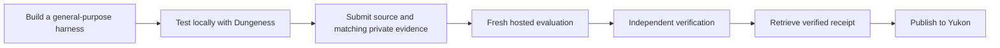

# OpenRSI architecture

OpenRSI is the platform and benchmark. The `openrsi-space` command and
`openrsi-space` Python package are its solver toolkit; `openrsi-space-verifier`
is its private verification service. Dungeness remains the execution runtime,
and Yukon provides identity and the leaderboard UI. Python imports use
`openrsi_space` and `openrsi_space_verifier`. New client settings use `OPENRSI_*`
and new local state uses `.openrsi/`; existing records and signed receipts remain
readable through the compatibility layer.

The standard workflow is **build → test locally with Dungeness → fix failures →
remote evaluation → publish the verified receipt to Yukon**.

| Component | Role |
| --- | --- |
| Your local coding agent | Helps build and test the general-purpose harness with your authorization. |
| Submitted harness | Runs autonomously: reads its assignment, calls models, edits and evaluates candidates. |
| `openrsi-space` CLI | Packages the harness and assigned problem, starts local runs and submits official evaluations. |
| Dungeness | Public execution backend coordinating Docker containers, the model gateway, problem service and evaluator; meters usage, enforces limits and records evidence. |
| OpenRSI verifier | Hosted service that screens source, runs Dungeness, independently verifies results and issues receipts. |
| Yukon | Validates the receipt's retained result and displays accepted submissions; does not repeat inference. |

Start with [local testing](local-evaluation.md): install Git, uv and Docker,
clone a clean Dungeness checkout anywhere, discover the active problem release,
and use `openrsi-space local run HARNESS_DIR --dungeness PATH --prepare-only` with
configured model and limits. OpenRSI generates the run spec and starts local
services automatically during execution; no manual problem server is needed.

Preparation builds without model calls. With a separately authorized local budget,
remove `--prepare-only` and supply model access to test the full research loop.
Inspect failures and fix the harness before remote submission. Keep each evaluation
fresh; do not carry local solutions or task-specific notes into the harness.
Local results do not replace private screening, independent verification or receipts.
The CLI reuses a matching ended local run before submission; `--local-run PATH`
selects records elsewhere. For platform-funded submissions, the CLI uploads a
separate private bundle of recorded model exchanges, settled usage and evaluation
events. Admission checks source/problem/model matching and requires the recorded local budget cap to cover the remote cap; actual spending may be lower. A bounded LLM review checks readiness, not complete
state replay or authenticity. The remote run starts fresh; local candidates do not
become its starting point. See [funding and evidence](platform-funded-inference.md).

Every new hosted submission requires local evidence. If local testing is blocked
or declined, stop and resolve the blocker before submitting. Allowance overrides
change spending limits only; they cannot waive the evidence requirement.

## Public repository

`openrsi-space` provides the solver CLI, temporary credential encoding,
canonical source bundles, local build/smoke tools, pinned problem definition,
pricing and score validation, receipt retrieval and Yukon integration.
The public library uses the Python standard library and PyYAML. Local Docker smoke tests
require Docker; problem verification requires the upstream task's toolchain.

The public entrypoint is `openrsi-space`. It does not start the verification service,
run anti-cheat screening, hold an operator credential. The local-run path requires a Dungeness checkout;
remote submission uses the service’s runtime.
The challenge UI lives in Yukon; OpenRSI does not include a separate viewer.

The public ECDSA statement lives in `src/openrsi_space/problem-set/ecdsa-fail/description.md`.
The private service copies it into a versioned problem package during
initialization. For each run, it builds a read-only problem service from
OpenRSI's `runtime/problem_server.py`, independently of the submitted harness.
Dungeness wires this service into Compose and exposes the assigned document
through the gateway's `GET /task`. See [the task contract](problem-service.md).

General-purpose memory and retrieval software can be part of the submitted
harness image; their bytes are covered by source and image identities. Do not
bundle problem-specific papers, notes or answers. The trusted problem service
supplies the assigned library at runtime, and each run builds its own fresh memory.
OpenRSI does not prescribe the harness’s reading or indexing strategy.

## Module boundaries

`cli/` parses arguments and coordinates commands. `client/` owns HTTP, login
sessions, resumable submission state and catalog downloads. `contracts/` owns
validation, accounting and result bindings shared with the verifier; it has no
HTTP, CLI or execution dependency. `harnesses/` owns local Docker build/smoke
mechanics, while `integrations/` adapts Dungeness and Yukon.

Small shared primitives and credential/profile helpers remain at package root.
Old import paths forward to the owning modules so existing verifier versions
and callers keep working. Add new code to the canonical packages. See the
[development ownership table](development.md#ownership) and directory READMEs.

## Challenge code and content

`src/openrsi_space/challenge/` owns shared release loading, resource validation and
preparation, asset installation, and assigned task assembly. Its directory README
identifies the entry points. Public callers use `openrsi_space.challenge.*`; the old
`problems`, `problem_assets`, `paper_library`, `knowledge_base`, and `task_setup`
module paths remain compatibility aliases for existing verifier releases.

`src/openrsi_space/problem-set/` owns the challenge content: descriptions, release
manifests, paper catalogs, scaffolds and verifier bundles. Its paths and published
content stay stable when preparation code moves. Pricing remains in `pricing/`.

## Hosted evaluation

The hosted OpenRSI service reviews submissions, executes fresh evaluations and
independently verifies results. Solvers use its public API through the CLI;
no private package or operator credential is required.

The [remote API contract](remote-evaluation.md) describes authentication, request
IDs, status, diagnostics and receipts. Updating a client does not update the
hosted service or change retained evaluations.

## Trust and privacy

For platform-funded remote runs, the solver submits no personal model credential.
The operator supplies API access through the trusted gateway. Local model tests
still use the solver’s separately authorized access. The uploaded local evidence
is private, screened for secrets and sampled by a third-party LLM; it is never
added to public harness source.

For user-funded runs, the solver authorizes use of their model account for the
selected run and cap. Refresh credentials remain local. Model access is sent
separately from source and receipts over authenticated HTTPS. See
[model access](live-models.md).

The service binds evidence to the authenticated owner, pinned problem,
source/image/configuration/pricing/policy identities and metered usage. Yukon
accepts only the result retrieved by its trusted workflow. Locally edited
score JSON is not authoritative.

New submissions require public harness source, published after the run stops and
publication screening passes. Solvers cannot opt out or unpublish source. Traces are retained internally for verification and debugging. Historical private runs stay private. Owners can download
harness source or add an authorized license; see [artifact sharing](artifact-sharing.md).
The UI reads Yukon's official metrics and requests artifact metadata only when
run details are opened. It does not enumerate private evaluations.
